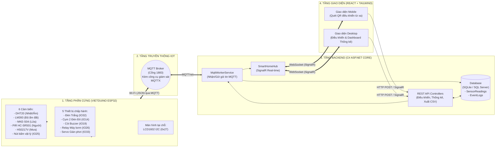
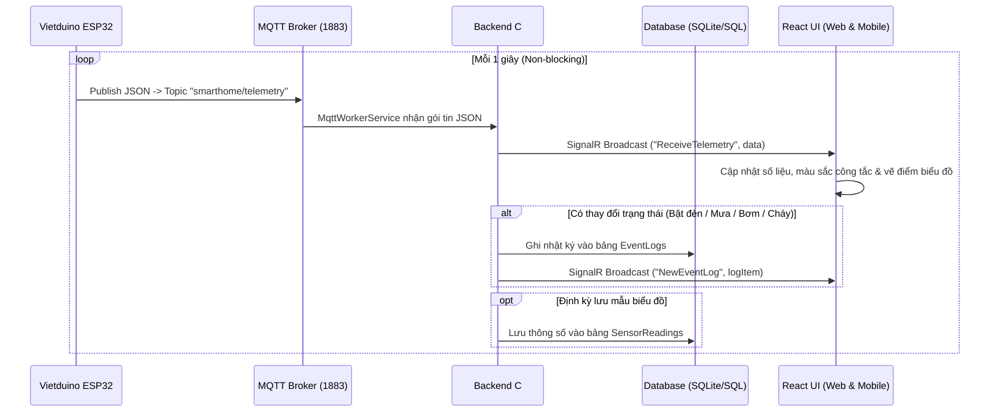
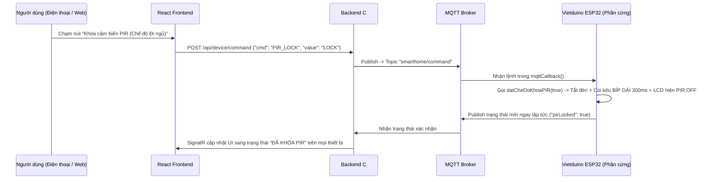

# 📘 TÀI LIỆU ĐẶC TẢ CHỨC NĂNG & LUỒNG HỆ THỐNG: WEB / MOBILE ĐIỀU KHIỂN TỪ XA & DASHBOARD QUẢN LÝ SMART HOME – SMART GARDEN

> [!IMPORTANT]
> Tài liệu này dùng làm **bản thiết kế chuẩn (Blueprint)** cho cả nhóm phát triển dự án **Ngôi nhà & Khu vườn Thông minh (Vietduino ESP32 + C# ASP.NET Core + React & Tailwind CSS)**. Toàn bộ thành viên (Nhúng ESP32, Backend C#, Frontend React) dựa vào tài liệu này để nắm rõ hệ thống có những màn hình nào, gồm những nút bấm/biểu đồ gì và dữ liệu chạy qua lại như thế nào.

---

## 1. TỔNG QUAN MỤC TIÊU CỦA PHẦN MỀM WEB / MOBILE

Hệ thống phần mềm được xây dựng dưới dạng **Responsive Web Application (chuẩn Desktop & Mobile Web App)** kết nối thời gian thực với bo mạch **Vietduino ESP32** để giải quyết 2 bài toán cốt lõi:

1. **Phân hệ 1 — Điều khiển & Giám sát Thời gian thực (`Live Remote Control` - Tối ưu cho cả Điện thoại & Laptop):**
   * Giúp chủ nhà xem tức thời mọi thông số cảm biến trong nhà và ngoài vườn (độ trễ `< 100ms`).
   * Điều khiển bật/tắt thiết bị từ xa với cơ chế **Đồng bộ 2 chiều (`2-Way Sync`)**: Bấm nút vật lý trên mạch thì giao diện Web/Mobile nhảy theo; bấm nút trên Web/Mobile thì thiết bị trên mạch thực thi ngay.
2. **Phân hệ 2 — Dashboard Quản lý, Thống kê & Báo cáo (`Analytics & Management Dashboard` - Tối ưu cho màn hình quản lý):**
   * Tổng hợp dữ liệu lịch sử thành các chỉ số thống kê (`Max`, `Min`, `Trung bình`, số lần hoạt động).
   * Biểu diễn sự biến thiên môi trường qua biểu đồ trực quan, lưu vết toàn bộ lịch sử sự kiện (`Audit Logs`) và xuất báo cáo ra file **Excel (`.CSV`)**.

---

## 2. SƠ ĐỒ KIẾN TRÚC & 4 LUỒNG DỮ LIỆU CỐT LÕI (SYSTEM DATA FLOWS)

### 2.1. Sơ đồ Kiến trúc Tổng thể Toàn Hệ thống

---

### 2.2. Chi tiết 4 Luồng Hoạt Động (Sequence Flows)

#### 🔹 Luồng 1: Luồng Giám sát Cảm biến Thời gian thực (`Telemetry Flow` — Mỗi 1 giây/lần)
1. **Tại ESP32:** Cứ mỗi `1000ms`, ESP32 gom toàn bộ thông số hiện tại (Nhiệt độ, Độ ẩm khí, Độ ẩm đất, Giá trị lửa, Trạng thái PIR, Mưa, Đèn trắng, Đèn đỏ, Máy bơm, Góc Servo) đóng gói thành 1 chuỗi `JSON` và `Publish` lên Topic `smarthome/telemetry`.
2. **Tại Backend C#:** `MqttWorkerService` nhận gói tin `JSON`:
   * Đẩy ngay lập tức gói tin đó qua **`SignalR Hub`** xuống tất cả trình duyệt Laptop và Điện thoại đang mở (độ trễ `< 20ms`).
   * Kiểm tra xem có sự thay đổi trạng thái nào không (ví dụ: Đèn vừa chuyển từ `OFF` sang `ON`, hoặc Mưa vừa chuyển từ `Kho` sang `CO_MUA`) $\rightarrow$ Nếu có, tự động ghi 1 dòng vào bảng **`EventLogs`**.
   * Định kỳ (mỗi `5–10 giây` hoặc khi thông số biến động), lưu 1 bản ghi vào bảng **`SensorReadings`** để vẽ biểu đồ lịch sử.
3. **Tại Giao diện React:** Nhận sự kiện SignalR `ReceiveTelemetry`, tự động cập nhật con số trên các thẻ cảm biến, đổi màu công tắc và vẽ thêm điểm mới vào biểu đồ thời gian thực mà không cần tải lại trang.

---

#### 🔹 Luồng 2: Luồng Điều khiển Thiết bị Từ xa (`Remote Control Flow` — Từ Điện thoại / Laptop xuống Mạch)
1. **Tại Giao diện React:** Người dùng chạm vào một công tắc trên Điện thoại hoặc Laptop (ví dụ: Bấm nút **"Bật Đèn Phòng Khách"** hoặc **"Khóa cảm biến PIR"**).
2. **Tại Backend C#:** Nhận lệnh qua API `POST /api/device/command` (hoặc qua SignalR Hub):
   * Ghi nhận vào bảng `EventLogs` (ví dụ: `"[ĐIỀU KHIỂN TỪ XA] Người dùng bật Đèn Trắng từ Web/Mobile"`).
   * Phát lệnh `JSON` xuống Topic MQTT `smarthome/command` (ví dụ: `{"cmd": "LIGHT", "value": "ON"}`).
3. **Tại ESP32:** Hàm `mqttCallback()` trên ESP32 bắt được gói tin tức thời:
   * Gọi trực tiếp hàm phần cứng tương ứng (`datTrangThaiDen(true)` hoặc `datCheDoKhoaPIR(true)` làm còi kêu Bíp).
   * Ngay lập tức gửi gói tin `smarthome/telemetry` mới nhất lên Server để xác nhận thiết bị thật đã đổi trạng thái thành công.

---

#### 🔹 Luồng 3: Luồng Đồng bộ 2 Chiều khi Tác động Vật lý tại Mạch (`Physical-to-Web Sync`)
* **Tình huống:** Người dùng không cầm điện thoại mà dùng tay **bấm trực tiếp vào Nút bấm vật lý 4 chân (`IO25`)** trên Breadboard (bấm nhả ngắn để Bật/Tắt đèn, hoặc đè giữ 1.2 giây để Khóa/Mở PIR), hoặc **đi ngang qua cảm biến PIR (`IO27`)** làm đèn tự sáng.
* **Luồng xử lý:**
  1. ESP32 xử lý bật/tắt đèn và phát tiếng còi Bíp ngay tại mạch (độ trễ `0ms`).
  2. Gói tin `telemetry` tiếp theo gửi trạng thái mới (`"lightOn": false` hoặc `"pirLocked": true`) lên Backend C#.
  3. Giao diện React trên Điện thoại và Laptop **tự động gạt nút công tắc trên màn hình theo đúng trạng thái ngoài đời thật** và hiển thị thông báo Toast: *"Nút vật lý tại mạch vừa tắt Đèn Trắng"*.

---

#### 🔹 Luồng 4: Luồng Cảnh báo Cháy Khẩn cấp Đa kênh (`Emergency Fire Alert Flow`)
* **Tình huống:** Cảm biến lửa `MKE-S04` (`IO34`) phát hiện ngọn lửa (`giaTriLua < 15` liên tục trong `1 giây`).
* **Luồng xử lý đồng thời tại Mạch & trên Web/Mobile:**
  1. **Tại Mạch:** Còi `IO19` hú liên hồi, Cụm 2 Đèn Đỏ `IO14` chớp nháy theo nhịp còi, Màn hình `LCD1602` hiện `"!! CANH BAO !! / PHAT HIEN LUA!"`, Máy bơm (nếu đang chạy) tự động ngắt để dồn nguồn.
  2. **Trên Web & Điện thoại:** Ngay khi nhận `"fireAlert": true`:
     * Toàn bộ giao diện bật **Hộp thoại Cảnh Báo Khẩn Cấp Màu Đỏ Nhấp Nháy (`Emergency Modal`)** đè lên màn hình.
     * Phát âm thanh còi báo động trực tiếp trên loa Điện thoại / Laptop.
     * Ghi sự kiện mức **`[KHẨN CẤP - CRITICAL]`** màu đỏ vào đầu bảng Nhật ký.

---

## 3. ĐẶC TẢ CHI TIẾT PHÂN HỆ 1: GIAO DIỆN ĐIỀU KHIỂN & GIÁM SÁT (`WEB / MOBILE CONTROL`)

Giao diện được chia thành các khối rõ ràng, khi mở trên **Laptop** sẽ xếp dạng lưới 2–3 cột; khi mở trên **Điện thoại** sẽ tự động xếp dọc 1 cột như ứng dụng di động thực thụ:

### 3.1. Thanh Trạng Thái Đầu Trang (`Top Navigation & Connection Bar`)
* **Logo & Tên hệ thống:** `SMART HOME & GARDEN - VIETDUINO ESP32`.
* **Chuyển đổi 2 Tab chính:** `[🎛️ Điều Khiển & Giám Sát]` và `[📊 Dashboard Thống Kê & Nhật Ký]`.
* **Huy hiệu Trạng thái Kết nối Mạch (`Connection Badge`):**
  * 🟢 **`ESP32 TRỰC TUYẾN (ONLINE)`**: Khi nhận được gói tin từ mạch đều đặn (kèm đồng hồ đếm: *"Cập nhật 1 giây trước"*).
  * 🔴 **`MẤT KẾT NỐI MẠCH (OFFLINE)`**: Nếu quá 5 giây không thấy ESP32 gửi tin lên.
* **Nút `[📱 Mã QR Mobile]`:** Khi bấm vào sẽ hiện Popup chứa **Mã QR Code** địa chỉ IP nội bộ của trang Web để các thành viên hoặc giảng viên lấy điện thoại quét là mở được App điều khiển ngay trên điện thoại.

---

### 3.2. Cụm 4 Thẻ Thông Số Môi Trường Trực Tiếp (`Live Sensor Cards`)

| Thẻ hiển thị | Dữ liệu từ ESP32 | Chi tiết hiển thị trực quan trên Giao diện |
| :--- | :--- | :--- |
| **1. Nhiệt độ Phòng** *(DHT20 - `0x38`)* | `temp` (`°C`) | - Con số lớn rõ nét (ví dụ: **`32.4 °C`**). - Nhãn đánh giá tự động: `< 26°C` (*Mát mẻ* - Xanh dương), `26–33°C` (*Bình thường* - Xanh lá), `> 33°C` (*Nóng bức* - Cam/Đỏ). |
| **2. Độ ẩm Không khí** *(DHT20 - `0x38`)* | `hum` (`%`) | - Con số lớn (ví dụ: **`67 %`**) kèm thanh tiến trình (`Progress Bar`). - Nhãn đánh giá: `< 45%` (*Khô*), `45–75%` (*Lý tưởng*), `> 75%` (*Ẩm ướt*). |
| **3. Độ ẩm Đất Vườn** *(LM393 - `IO35`)* | `soil` (`%`) | - Con số phần trăm (ví dụ: **`38 %`**) kèm biểu tượng mực nước. - Hiển thị vạch ngưỡng: **`< 30%` (Đất khô - Cần tưới)** màu Cam; **`>= 40%` (Đất đủ ẩm)** màu Xanh lá. |
| **4. An ninh & Thời tiết** *(Lửa `IO34` + Mưa `IO23` + PIR `IO27`)* | `flame`, `fireAlert`, `rain`, `pir` | - **Trạng thái Lửa:** `An toàn (Chỉ số: 45)` 🟢 hoặc `CẢNH BÁO CHÁY! (Chỉ số: 3)` 🔴. - **Trạng thái Thời tiết:** `Trời Khô Ráo` ☀️ hoặc `Đang Có Mưa` 🌧️. - **Trạng thái Chuyển động:** `Có người (PIR: CO)` 🚶 hoặc `Không có người` ⚪. |

---

### 3.3. Cụm 4 Bảng Điều Khiển Thiết Bị 2 Chiều (`Interactive Device Control Panels`)

#### 💡 Khối 1: Điều khiển Đèn Phòng Khách (`IO32`) & Cảm biến Chuyển động (`PIR IO27`)
* **Trạng thái hiển thị:** Icon bóng đèn phát sáng màu vàng rực khi `lightOn == true`, màu xám khi `lightOn == false`.
* **Các nút điều khiển:**
  1. **Công tắc `BẬT / TẮT ĐÈN TRẮNG`:** Bấm để bật hoặc tắt đèn phòng khách ngay lập tức từ xa. *(Khi tắt đèn, hệ thống tự động khóa tạm PIR 5 giây giống hệt nút bấm vật lý).*
  2. **Công tắc Chế độ Cảm biến PIR (`TỰ ĐỘNG BẬT ĐÈN` $\leftrightarrow$ `KHÓA PIR - CHẾ ĐỘ ĐI NGỦ`):**
     * Khi ở **`TỰ ĐỘNG (AUTO)`**: Hiển thị dòng chữ xanh *"Cảm biến PIR đang hoạt động: Tự động bật đèn khi có người bước vào"*.
     * Khi gạt sang **`KHÓA PIR (CHẾ ĐỘ ĐI NGỦ)`**: Gửi lệnh xuống mạch làm **Còi trên mạch kêu 1 tiếng BÍP DÀI**, màn hình LCD hiện `PIR:OFF`, vô hiệu hóa việc tự bật đèn khi có người đi qua. Khi gạt mở lại, còi trên mạch kêu **2 tiếng BÍP-BÍP**.

#### 👕 Khối 2: Điều khiển Giàn Phơi Quần Áo Thông Minh (`Servo SG90 IO33` & `Mưa IO23`)
* **Trạng thái hiển thị:**
  * Hình minh họa thanh giàn phơi đang **Đưa ra ngoài trời (`Góc 15°`)** ☀️ hoặc **Thu vào dưới mái hiên (`Góc 165°`)** 🏠.
  * Trạng thái cảm biến mưa: `Khô ráo` hoặc `Đang mưa`.
* **3 Nút chọn chế độ hoạt động:**
  1. **`[🤖 Tự Động Theo Mưa]` *(Mặc định)*:** Trời nắng tự đưa ra `15°`, có mưa (`0.6s`) tự thu vào `165°`, hết mưa (`2s`) tự đưa ra lại.
  2. **`[☀️ Cưỡng Bức Đưa Đồ Ra (15°)]`:** Chủ động đưa giàn phơi ra ngoài từ điện thoại.
  3. **`[🏠 Cưỡng Bức Thu Đồ Vào (165°)]`:** Chủ động thu quần áo vào nhà từ xa ngay trên điện thoại (ví dụ: thấy trời sắp chuyển mưa khi đang đi làm).

#### 💦 Khối 3: Điều khiển Hệ thống Tưới Cây & Bảo vệ Máy Bơm (`Relay IO26` & `Đất IO35`)
* **Trạng thái hiển thị:**
  * Trạng thái Máy bơm: `ĐANG NGHỈ`, `ĐANG BƠM TƯỚI (2.5s)` *(kèm hiệu ứng 2 Đèn Đỏ chớp nháy)*, `ĐANG CHỜ NƯỚC NGẤM (12s)`, hoặc `⚠️ ĐÃ KHÓA BƠM AN TOÀN (Lỗi hết nước / Tuột đầu dò)`.
  * Bộ đếm số đợt tưới liên tiếp: **`Số lần tưới: 1 / 5 đợt`**.
* **Các nút điều khiển:**
  1. **`[🚿 Tưới Nước Ngay (1 Đợt 2.5s)]`:** Bấm để kích hoạt máy bơm tưới cây ngay lập tức từ xa (kể cả khi đất đang trên 30%).
  2. **`[🛑 Dừng Bơm Khẩn Cấp]`:** Ngắt máy bơm ngay lập tức nếu bơm đang chạy.
  3. **`[🔓 Mở Khóa Máy Bơm (Reset Lỗi)]`:** Khi máy bơm đã tưới 5 lần mà đất chưa ướt và bị khóa (`pumpLocked == true`), sau khi châm thêm nước vào bình, người dùng có thể bấm nút này trên Web/Mobile để mở khóa máy bơm từ xa.

#### 🚨 Khối 4: Hệ thống Báo Cháy & Đèn Cảnh Báo Đỏ (`Lửa IO34` + `Còi IO19` + `2 Đèn Đỏ IO14`)
* **Trạng thái hiển thị:**
  * Trạng thái Cụm 2 Đèn Đỏ (`IO14`): `TẮT` hoặc `ĐANG CHỚP CẢNH BÁO`.
  * Trạng thái Còi báo động (`IO19`): `IM LẶNG` hoặc `ĐANG HÚ BÁO CHÁY`.
* **Các nút điều khiển:**
  1. **`[🔔 Kiểm Tra Còi & Đèn Đỏ (Test Alarm)]`:** Khi bấm nút này trên Web/Điện thoại, mạch ESP32 sẽ cho Còi kêu Bíp và chớp Cụm 2 Đèn Đỏ trong 2 giây để kiểm tra hệ thống cảnh báo còn hoạt động tốt không.
  2. **Màn hình Khẩn cấp (`Fire Alert Overlay`):** Tự động bung toàn màn hình khi `fireAlert == true`, có nút **`[Đã Xác Nhận & Tắt Chuông Báo Trên Web]`**.

---

## 4. ĐẶC TẢ CHI TIẾT PHÂN HỆ 2: DASHBOARD QUẢN LÝ & THỐNG KÊ (`ANALYTICS DASHBOARD`)

Khi chuyển sang Tab **`[📊 Dashboard Thống Kê & Nhật Ký]`**, người dùng sẽ có cái nhìn toàn cảnh về dữ liệu vận hành của ngôi nhà:

### 4.1. Dải 4 Thẻ Chỉ Số Thống Kê Tổng Hợp (`KPI Summary Cards`)
1. **Thống kê Nhiệt độ (`°C`):** Hiển thị `Cao nhất (Max)` | `Thấp nhất (Min)` | `Trung bình (Avg)` trong phiên/ngày.
2. **Thống kê Độ ẩm Không khí & Đất (`%`):** Hiển thị `Độ ẩm khí TB` và `Độ ẩm đất TB`.
3. **Thống kê Tưới tiêu (`Smart Garden`):** `Tổng số lần máy bơm đã chạy` + `Tổng thời gian bơm (giây)` + `Lượng nước ước tính đã tưới (ml)` *(dựa trên lưu lượng bơm ~25ml/giây)*.
4. **Thống kê Sự kiện An ninh & Tự động hóa:** `Số lần phát hiện người (PIR)` | `Số lần mưa thu đồ` | `Số lần cảnh báo cháy`.

---

### 4.2. Hệ thống Biểu đồ Trực quan (`Charts Section`)
1. **Biểu đồ 1 — Biến thiên Nhiệt độ & Độ ẩm Không khí theo Thời gian (`Dual-Axis Line Chart`):**
   * Trục ngang (`X`): Mốc thời gian (`HH:mm:ss`).
   * Đường 1 (Màu Đỏ/Cam): Nhiệt độ (`°C`).
   * Đường 2 (Màu Xanh dương): Độ ẩm không khí (`%`).
2. **Biểu đồ 2 — Biến thiên Độ ẩm Đất & Ngưỡng Tưới Tự Động (`Area Chart`):**
   * Đường biểu diễn độ ẩm đất (`0% -> 100%`).
   * Có 2 đường kẻ ngang cố định để dễ quan sát khi thuyết trình:
     * Đường đứt nét màu Đỏ tại mốc **`30%` (Ngưỡng kích hoạt tưới)**.
     * Đường đứt nét màu Xanh lá tại mốc **`40%` (Ngưỡng đất đủ ẩm)**.

---

### 4.3. Bảng Nhật Ký Hoạt Động Hệ Thống & Xuất Báo Cáo (`System Audit Logs & CSV Export`)
* **Cấu trúc bảng Nhật ký:**

| Thời gian (`Timestamp`) | Phân loại (`Category`) | Nguồn kích hoạt (`Source`) | Nội dung sự kiện chi tiết (`Message`) |
| :---: | :---: | :---: | :--- |
| `20:55:12 24/11/2026` | 🚶 **`[CHUYỂN ĐỘNG PIR]`** | Tự động tại mạch | Phát hiện có người bước vào -> Tự động BẬT Đèn Trắng (`IO32`). |
| `20:55:40 24/11/2026` | 🎛️ **`[ĐIỀU KHIỂN]`** | Nút bấm vật lý (`IO25`) | Người dùng đè giữ nút 1.2s -> KHÓA cảm biến PIR (Chế độ Đi ngủ). |
| `20:56:05 24/11/2026` | 🌧️ **`[GIÀN PHƠI]`** | Cảm biến mưa (`IO23`) | Phát hiện trời mưa (0.6s) -> Servo quay THU ĐỒ vào mái hiên (`165°`). |
| `20:57:10 24/11/2026` | 💦 **`[TƯỚI CÂY]`** | Tự động / Web | Đất khô (`24% < 30%`) -> Bật Máy bơm tưới đợt `1/5` trong `2.5 giây`. |
| `20:58:00 24/11/2026` | 🚨 **`[BÁO CHÁY]`** | Cảm biến lửa (`IO34`) | **KHẨN CẤP:** Phát hiện lửa (`Chỉ số: 4 < 15`) -> Kích hoạt Còi & 2 Đèn Đỏ! |

* **Công cụ Quản lý trên Bảng Nhật ký:**
  * **Bộ lọc nhanh (`Filter Tabs`):** `[Tất cả]`, `[🚨 Báo cháy]`, `[💦 Tưới cây]`, `[🌧️ Giàn phơi]`, `[💡 Đèn & PIR]`, `[📱 Điều khiển từ xa]`.
  * **Nút `[📥 Xuất Báo Cáo Excel (.CSV)]`:** Tải toàn bộ bảng nhật ký và lịch sử thông số cảm biến về máy tính dưới dạng file `.CSV` (mở trực tiếp bằng Microsoft Excel có đầy đủ tiếng Việt có dấu `UTF-8 with BOM`).

---

## 5. BẢNG PHÂN CHIA CÔNG VIỆC TRONG NHÓM (DỰA TRÊN TÀI LIỆU NÀY)

| Mảng công việc | Thư mục trong Git | Nhiệm vụ cụ thể trong Tuần này |
| :--- | :---: | :--- |
| **1. Mảng Nhúng & IoT** *(ESP32 Firmware)* | `1-firmware-esp32/` | - Giữ nguyên logic phần cứng ổn định của 13 thiết bị. - Tích hợp Wi-Fi + MQTT Client (`PubSubClient`). - Gửi JSON `smarthome/telemetry` mỗi 1 giây và nhận xử lý 5 lệnh JSON tại `smarthome/command`. |
| **2. Mảng Backend & DB** *(C# ASP.NET Core)* | `2-backend-csharp/` | - Viết `MqttWorkerService` kết nối MQTT Broker. - Xây dựng `SignalR Hub` đẩy dữ liệu thời gian thực lên React. - Thiết kế Database (`SensorReadings`, `EventLogs`) bằng EF Core + SQLite. - Viết các API: `POST /api/device/command`, `GET /api/analytics/summary`, `GET /api/logs/export-csv`. |
| **3. Mảng Frontend UI** *(React + Tailwind)* | `3-frontend-react/` | - Dựng giao diện Responsive 2 Tab (`Điều khiển` & `Dashboard Thống kê`). - Kết nối `SignalR` nhận dữ liệu live và gọi API điều khiển 2 chiều. - Tích hợp biểu đồ `Recharts`/`Chart.js`, Modal Báo cháy khẩn cấp và Mã QR Mobile. |
